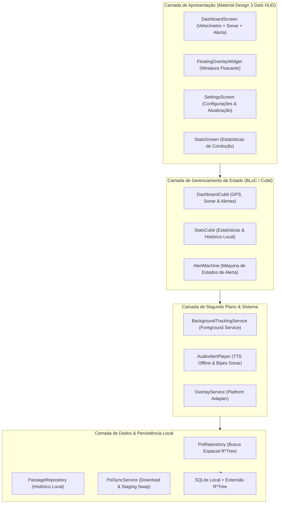

# Arquitetura do Sistema

A arquitetura do **Sentinela** é fundamentada em separação estrita de camadas e programação reativa com **BLoC / Cubit**, garantindo testabilidade hermética com cobertura $\ge 90\%$.

---

## 🏗️ Visão em Camadas



---

## 🧩 Detalhamento dos Módulos

```
sentinela/
├── lib/
│   ├── core/                  # Módulos puros (fórmulas geodésicas, AlertMachine, Hardware/Sensores)
│   │   ├── audio/             # Gerenciamento de áudio, TTS pt-BR nativo e cadência sonar
│   │   ├── engine/            # AlertMachine (Máquina de estados finitos reativa)
│   │   ├── geo/               # Haversine, Bearing e Bounding Box
│   │   ├── hardware/          # WakelockManager (gestão de tela ativa no painel)
│   │   ├── location/          # LocationService (GPS nativo e gerenciamento de permissões)
│   │   ├── models/            # POI, Radar, TrafficLight, VehiclePosition
│   │   ├── network/           # ConnectivityChecker (detecção de Wi-Fi e dados móveis)
│   │   └── theme/             # Material Design 3 Dark HUD de alto contraste
│   ├── data/                  # Persistência e comunicação com dados abertos
│   │   ├── database/          # SQLite R*Tree nativo pré-compilado
│   │   ├── repository/        # PoiRepository com Bounding Box
│   │   └── sync/              # In-App Sync Engine com Staging Swap atômico e validação Wi-Fi
│   ├── features/              # Apresentação e Telas do Condutor
│   │   ├── dashboard/         # HUD M3, velocímetro digital monoespaçado e sonar
│   │   ├── overlay/           # Miniatura flutuante Picture-in-Picture
│   │   ├── settings/          # Atualização in-app, switches de Wi-Fi e Wakelock
│   │   └── stats/             # Estatísticas de conformidade e passagens
│   ├── background/            # Foreground Service e isolamento de ciclo de vida
│   └── main.dart              # Ponto de entrada do aplicativo e overlayMain
└── test/                      # Suíte de testes automatizados BDD/TDD (100% Hermética)
```

---

## 📱 Camada de Plataforma Nativa, Sensores & Hardware

Para viabilizar a execução nos sistemas móveis sem comprometer a testabilidade hermética no ambiente headless Linux da esteira de CI, todos os plugins de sistema operacional utilizam o padrão **Ports & Adapters (Clean Architecture)**:

1. **Geolocalização Contínua (`LocationService`):**
   * Interface abstrata que permite mock total em testes GPX e injeção transparente de `GeolocatorLocationService` em produção móvel (`LocationAccuracy.bestForNavigation`).
2. **Gestão de Tela Ativa (`WakelockManager`):**
   * Previne o escurecimento e desligamento do display durante a condução no painel (`PlatformWakelockManager`), configurável nas opções do motorista.
3. **Checagem de Wi-Fi para Sincronização Segura (`NetworkConnectivityChecker`):**
   * Garante que a ingestão sob demanda de dezenas de milhares de radares ocorra prioritariamente sob rede Wi-Fi, preservando o plano de dados móveis 4G/5G do condutor.
4. **Síntese de Voz Nativa Offline (`PlatformTtsEngine`):**
   * Implementação concreta de `TtsEngineInterface` operando com motor `pt-BR` e Audio Ducking.

---

## ⚡ Fluxo de Execução Concorrente com Isolates

Para assegurar uma taxa de quadros ininterrupta de 60 a 120 fps no velocímetro durante a ingestão de bases de dados massivas com dezenas de milhares de registros, operações de rede e parsing JSON são descarregadas para `Isolates` independentes via `compute()`.
