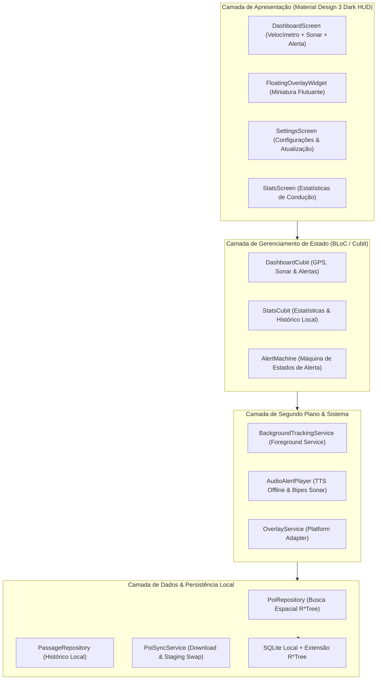

# Arquitetura do Sistema

A arquitetura do **Sentinela** é fundamentada em separação estrita de camadas e programação reativa com **BLoC / Cubit**, garantindo testabilidade hermética com cobertura $\ge 90\%$.

---

## 🏗️ Visão em Camadas



---

## 🧩 Detalhamento dos Módulos

```
sentinela/
├── lib/
│   ├── core/                  # Módulos puros (fórmulas geodésicas, AlertMachine, Hardware/Sensores)
│   │   ├── audio/             # Gerenciamento de áudio, TTS pt-BR nativo e cadência sonar
│   │   ├── engine/            # AlertMachine (Máquina de estados finitos reativa)
│   │   ├── geo/               # Haversine, Bearing e Bounding Box
│   │   ├── hardware/          # WakelockManager (gestão de tela ativa no painel)
│   │   ├── location/          # LocationService (GPS nativo e gerenciamento de permissões)
│   │   ├── models/            # POI, Radar, TrafficLight, VehiclePosition
│   │   ├── network/           # ConnectivityChecker (detecção de Wi-Fi e dados móveis)
│   │   └── theme/             # Material Design 3 Dark HUD de alto contraste
│   ├── data/                  # Persistência e comunicação com dados abertos
│   │   ├── database/          # SQLite R*Tree nativo pré-compilado
│   │   ├── repository/        # PoiRepository com Bounding Box
│   │   └── sync/              # In-App Sync Engine com Staging Swap atômico e validação Wi-Fi
│   ├── features/              # Apresentação e Telas do Condutor
│   │   ├── dashboard/         # HUD M3, velocímetro digital monoespaçado e sonar
│   │   ├── overlay/           # Miniatura flutuante Picture-in-Picture
│   │   ├── settings/          # Atualização in-app, switches de Wi-Fi e Wakelock
│   │   └── stats/             # Estatísticas de conformidade e passagens
│   ├── background/            # Foreground Service e isolamento de ciclo de vida
│   └── main.dart              # Ponto de entrada do aplicativo e overlayMain
└── test/                      # Suíte de testes automatizados BDD/TDD (100% Hermética)
```

---

## 📱 Camada de Plataforma Nativa, Sensores & Hardware

Para viabilizar a execução nos sistemas móveis sem comprometer a testabilidade hermética no ambiente headless Linux da esteira de CI, todos os plugins de sistema operacional utilizam o padrão **Ports & Adapters (Clean Architecture)**:

1. **Geolocalização Contínua (`LocationService`):**
   * Interface abstrata que permite mock total em testes GPX e injeção transparente de `GeolocatorLocationService` em produção móvel (`LocationAccuracy.bestForNavigation`).
2. **Gestão de Tela Ativa (`WakelockManager`):**
   * Previne o escurecimento e desligamento do display durante a condução no painel (`PlatformWakelockManager`), configurável nas opções do motorista.
3. **Checagem de Wi-Fi para Sincronização Segura (`NetworkConnectivityChecker`):**
   * Garante que a ingestão sob demanda de dezenas de milhares de radares ocorra prioritariamente sob rede Wi-Fi, preservando o plano de dados móveis 4G/5G do condutor.
4. **Síntese de Voz Nativa Offline (`PlatformTtsEngine`):**
   * Implementação concreta de `TtsEngineInterface` operando com motor `pt-BR` e Audio Ducking.
5. **Live Activities & Dynamic Island para iOS 16.1+ (`LiveActivityService`):**
   * Adaptador desacoplado (`PlatformLiveActivityAdapter` e `FakeLiveActivityPlatform`) para transmissão em tempo real de velocímetro, limite da via, distância regressiva ao radar e alertas visuais pulsantes na Dynamic Island e Tela de Bloqueio do iOS.

---

## 🎛️ Tolerâncias Customizadas & Modo Silencioso (`AlertPreferences`)

O motor de alertas suporta personalização fina das margens de fiscalização e comportamento acústico:
* **Margens de Tolerância:** Tolerância fixa (km/h) e percentual (%) para evitar falsos positivos de excesso de velocidade ao trafegar com velocímetros analógicos aferidos.
* **Modo Silencioso / Discreto (`alertOnlyIfOverSpeed`):** Emite avisos sonoros e síntese de voz apenas quando o condutor estiver acima da velocidade permitida na aproximação, garantindo viagens sem poluição sonora.
* **Tempo de Antecipação Dinâmica:** Parametrização customizável do horizonte temporal de aviso (10s a 25s), escalando a distância de frenagem conforme a velocidade real.

---

## 💾 Backup & Restauração 100% Offline (`BackupRestoreService`)

Fiel ao pilar de **Privacidade Absoluta e Soberania dos Dados**:
* **Exportação e Importação em JSON:** Permite ao condutor extrair todo o histórico local de passagens e suas preferências personalizadas para um arquivo JSON legível e aberto.
* **Zero Telemetria em Nuvem:** Operação estritamente local no armazenamento do dispositivo, sem intermediários ou APIs de terceiros.
* **Restauração Atômica:** Validação de esquema e versão antes da inserção local com rollback em caso de arquivo corrompido.

---

## 🔋 Amostragem Adaptativa de GPS & Gestão Térmica (`AdaptiveGpsSampler`)

Em trânsito lento ou paradas prolongadas (como semáforos ou engarrafamentos), consultas geodésicas de alta frequência sobre o índice R*Tree demandam processamento desnecessário.
O `AdaptiveGpsSampler` identifica automaticamente quando a velocidade do veículo permanece inferior a 5 km/h por mais de 30 segundos, relaxando a taxa de amostragem de 1 Hz (filtro de 2 metros) para 0.33 Hz (filtro de 10 metros). Assim que o veículo retoma movimento ($\ge 5\text{ km/h}$), o modo de alta responsividade de 1 Hz é restaurado imediatamente.

---

## 🩺 Diagnóstico e Saúde do Sistema (`SystemDiagnosticsService`)

Integrado diretamente ao painel principal do motorista, o serviço de diagnósticos executa auditorias ativas sob demanda:
* **Sensores e Permissões:** Validação de chip GPS e permissões em segundo plano (`whileInUse` ou `always`).
* **Integridade da Base SQLite R\*Tree:** Checagem de integridade e contagem total de POIs indexados, validando a execução de queries espaciais.
* **Tamanho e Armazenamento:** Verificação do espaço ocupado pela base compilada no disco.
* **Conectividade:** Status de rede Wi-Fi e dados móveis.

---

## 🚘 Modo Espelho HUD para Para-brisa (Condução Noturna)

O painel suporta projeção direta no para-brisa do veículo (*Head-Up Display* reflexivo):
* **Inversão Geométrica Horizontal:** O layout do velocímetro e alertas é espelhado no eixo horizontal através de transformação matricial `Transform(alignment: Alignment.center, transform: Matrix4.rotationY(pi), child: ...)`. Ao apoiar o smartphone no painel do carro à noite, a imagem refletida no vidro do para-brisa aparece perfeitamente orientada e legível para o motorista.
* **Contraste Puro OLED Black (`#000000`):** As superfícies e fundos mudam para preto absoluto, eliminando o ofuscamento visual noturno e reduzindo o consumo de energia em telas OLED.

---

## 🔊 Síntese Tonal de Proximidade & Efeito Sonar (`ToneGeneratorInterface`)

Além dos avisos falados por voz TTS, o Sentinela incorpora emissão de bipes sintetizados com frequências diferenciadas:
* **Tom de Aproximação (880 Hz / 80 ms):** Disparado em cadência proporcional à proximidade do radar ou lombada com velocidade compatível.
* **Tom Crítico de Excesso (1200 Hz / 120 ms):** Tom agudo urgente emitido quando o condutor está em excesso de velocidade na aproximação do ponto fiscalizado.
* **Ports & Adapters (`ToneGeneratorInterface`):** Abstração que isola os canais de hardware (`PlatformToneGenerator`) com `FakeToneGenerator` para execução hermética na suíte de testes em Linux/CI sem dependências de áudio nativo.

---

## 🛣️ Tarifação e Estimativa de Pedágio Free Flow (`TollRateEstimator`)

Para rodovias pedagiadas convencionais e modernos pórticos eletrônicos **Free Flow**:
* **Estimativa Determinística Offline:** Mapeamento de tarifas de referência sem dependência de internet, calibrado por categoria veicular (`VehicleCategory`: passeio, motocicleta, comercial e caminhão pesado).
* **Resumo de Viagem e Custos Acumulados (`TripTollSummary`):** Integração com `PassageRecord` e `PassageRepository`, registrando tarifas individuais e total acumulado em pedágios no painel de estatísticas privadas do motorista.

---

## 🚀 Cópia Segura no Primeiro Boot (`SeedDatabaseLoader`)

Para garantir operação 100% offline imediata no primeiro boot sem exigir download de rede:
1. O asset pré-embarcado `assets/db/sentinela_brasil.db` é verificado no armazenamento do dispositivo.
2. Se inexistente, é escrito atomicamente via arquivo temporário `.tmp` e renomeado após flushing de I/O, impedindo corrupção em caso de encerramento prematuro.

---

## ⚡ Fluxo de Execução Concorrente com Isolates

Para assegurar uma taxa de quadros ininterrupta de 60 a 120 fps no velocímetro durante a ingestão de bases de dados massivas com dezenas de milhares de registros, operações de rede e parsing JSON são descarregadas para `Isolates` independentes via `compute()`.

---

## ⏱️ Radar de Trecho e Velocidade Média (`SectionControlMachine`)

Projetado para trechos rodoviários monitorados por velocidade média:
* **Entrada e Saída Direcionais (`AverageSpeedCorridor`):** Cadastramento de pórticos de entrada e saída com coordenadas geodésicas e azimutes de aproximação.
* **Cálculo Contínuo em Tempo Real:** Odômetro cumulativo e cálculo dinâmico da velocidade média com tolerância legal.
* **Orientação Preventiva:** Projeta o tempo em segundos necessário para o condutor reduzir a velocidade e normalizar a média antes de cruzar o pórtico final.

---

## 🔒 Integridade Criptográfica SHA-256 da Base (`DatabaseIntegrityValidator`)

Garante a inviolabilidade do banco de dados SQLite local e dos pacotes de atualização OTA:
* **Checksum SHA-256:** Cálculo criptográfico do arquivo de dados antes da ativação atômica no dispositivo.
* **Auditoria Estrutural SQLite:** Execução de `PRAGMA integrity_check` para atestar ausência de corrupção de páginas e índices B-Tree/R*Tree.

---

## 🗺️ Exportador de Trajetos GPX 1.1 e KML 2.2 (`RouteExporter`)

Permite a extração e compartilhamento de viagens com total privacidade:
* **Padrões OGC e GPX 1.1:** Geração de arquivos estruturados com track points e waypoints de passagens por radares.
* **Cores Semânticas Material Design 3:** Diferenciação visual entre pontos conformes e excessos de velocidade.
* **100% Local e Hermético:** Execução direta no aparelho sem requisições a servidores externos.
