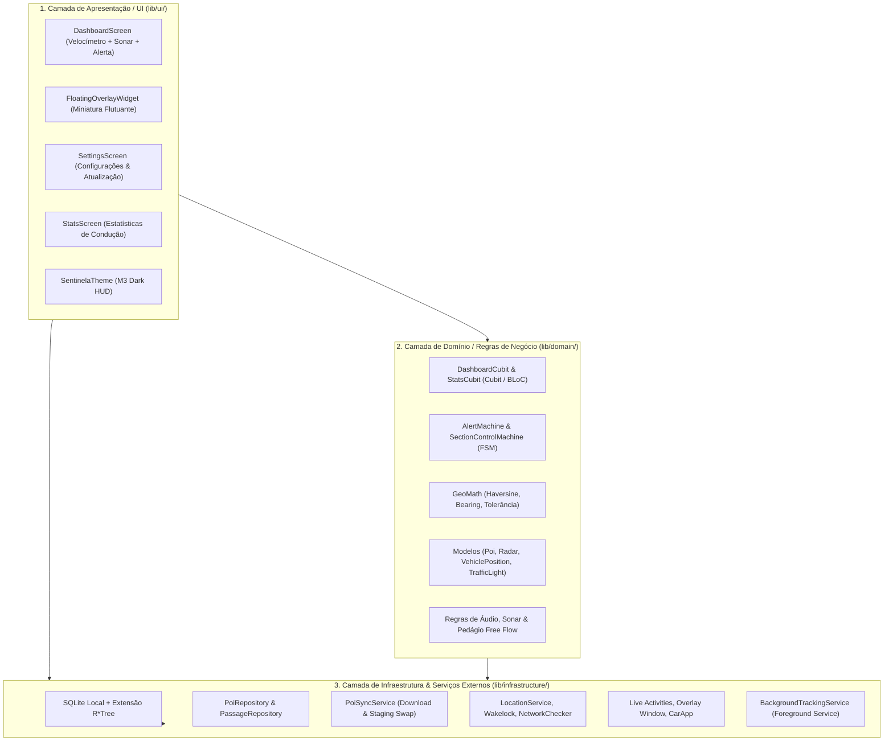

# Arquitetura do Sistema

A arquitetura do **Sentinela** é fundamentada em separação estrita de camadas e programação reativa com **BLoC / Cubit**, garantindo testabilidade hermética com cobertura $\ge 90\%$.

---

## 🏗️ Visão em 3 Camadas Canônicas

O Sentinela adota rigorosamente uma arquitetura em **3 camadas desacopladas** (Clean/Hexagonal Architecture), sem dependências circulares:



---

## 🧩 Detalhamento dos Módulos

```
sentinela/
├── lib/
│   ├── ui/                    # 1. APRESENTAÇÃO / UI
│   │   ├── screens/           # Telas completas (Dashboard, Settings, Stats)
│   │   ├── widgets/           # Componentes M3 puros (Speedometer, Sonar, AlertBanner, FloatingOverlay)
│   │   └── theme/             # Tema Dark HUD Material Design 3 e paleta de cores
│   ├── domain/                # 2. DOMÍNIO & REGRAS DE NEGÓCIO PURAS
│   │   ├── audio/             # Interface e regras acústicas (AudioAlertPlayer)
│   │   ├── automotive/        # Driver Distraction Guidelines e interface CarApp
│   │   ├── cubits/            # Gerenciamento de estado reativo (DashboardCubit, StatsCubit)
│   │   ├── engines/           # AlertMachine, SectionControlMachine, AdaptiveGpsSampler, PoiCluster
│   │   ├── export/            # Exportação de passagens (CSV, GPX, GeoJSON)
│   │   ├── l10n/              # Textos e internacionalização pt-BR
│   │   ├── math/              # Haversine, Bearing e cálculos geodésicos puros
│   │   ├── models/            # POI, Radar, TrafficLight, VehiclePosition, TollRate
│   │   ├── release/           # Auditoria de integridade de release e store compliance
│   │   └── toll/              # Estimativa de pedágio determinística Free Flow
│   ├── infrastructure/        # 3. ACESSO A DADOS & SERVIÇOS EXTERNOS
│   │   ├── backup/            # BackupRestoreService (JSON local atômico)
│   │   ├── background/        # BackgroundTrackingService (Android Foreground Service)
│   │   ├── database/          # SQLite R*Tree nativo pré-compilado e staging swap
│   │   ├── diagnostics/       # SystemDiagnosticsService (integridade, bateria, storage)
│   │   ├── location/          # GeolocatorLocationService (GPS e permissões nativas)
│   │   ├── platform/          # Adapters nativos: Wakelock, Overlay, LiveActivities, CarApp, TTS, Tone
│   │   ├── repositories/      # Implementações concretas de repositórios SQLite
│   │   ├── security/          # DatabaseIntegrityValidator (SHA-256 e PRAGMA integrity_check)
│   │   └── sync/              # In-App Sync Engine (OSM/CKAN com staging tables)
│   ├── core/                  # Barrel exports retrocompatíveis (geo, models, engine, theme, etc.)
│   ├── data/                  # Barrel exports retrocompatíveis (database, repository, sync)
│   ├── features/              # Barrel exports retrocompatíveis (dashboard, overlay, settings, stats)
│   ├── background/            # Barrel exports retrocompatíveis (background_service.dart)
│   └── main.dart              # Ponto de entrada do aplicativo e overlayMain
└── test/                      # Suíte de testes automatizados BDD/TDD (100% Hermética, ≥90% Cobertura)
```

> [!NOTE]
> **Compatibilidade Total via Barrel Exports:** Todos os arquivos históricos em `lib/core/`, `lib/data/`, `lib/features/` e `lib/background/` foram preservados como *barrel exports*, garantindo retrocompatibilidade imediata com 0% de quebra para integrações ou imports pré-existentes.

---

## 📱 Camada de Plataforma Nativa, Sensores & Hardware

Para viabilizar a execução nos sistemas móveis sem comprometer a testabilidade hermética no ambiente headless Linux da esteira de CI, todos os plugins de sistema operacional utilizam o padrão **Ports & Adapters (Clean Architecture)**:

1. **Geolocalização Contínua (`LocationService`):**
   * Interface abstrata que permite mock total em testes GPX e injeção transparente de `GeolocatorLocationService` em produção móvel (`LocationAccuracy.bestForNavigation`).
2. **Gestão de Tela Ativa (`WakelockManager`):**
   * Previne o escurecimento e desligamento do display durante a condução no painel (`PlatformWakelockManager`), configurável nas opções do motorista.
3. **Checagem de Wi-Fi para Sincronização Segura (`NetworkConnectivityChecker`):**
   * Garante que a ingestão sob demanda de dezenas de milhares de radares ocorra prioritariamente sob rede Wi-Fi, preservando o plano de dados móveis 4G/5G do condutor.
4. **Síntese de Voz Nativa Offline (`PlatformTtsEngine`):**
   * Implementação concreta de `TtsEngineInterface` operando com motor `pt-BR` e Audio Ducking.
5. **Live Activities & Dynamic Island para iOS 16.1+ (`LiveActivityService`):**
   * Adaptador desacoplado (`PlatformLiveActivityAdapter` e `FakeLiveActivityPlatform`) para transmissão em tempo real de velocímetro, limite da via, distância regressiva ao radar e alertas visuais pulsantes na Dynamic Island e Tela de Bloqueio do iOS.

---

## 🎛️ Tolerâncias Customizadas & Modo Silencioso (`AlertPreferences`)

O motor de alertas suporta personalização fina das margens de fiscalização e comportamento acústico:
* **Margens de Tolerância:** Tolerância fixa (km/h) e percentual (%) para evitar falsos positivos de excesso de velocidade ao trafegar com velocímetros analógicos aferidos.
* **Modo Silencioso / Discreto (`alertOnlyIfOverSpeed`):** Emite avisos sonoros e síntese de voz apenas quando o condutor estiver acima da velocidade permitida na aproximação, garantindo viagens sem poluição sonora.
* **Tempo de Antecipação Dinâmica:** Parametrização customizável do horizonte temporal de aviso (10s a 25s), escalando a distância de frenagem conforme a velocidade real.

---

## 💾 Backup & Restauração 100% Offline (`BackupRestoreService`)

Fiel ao pilar de **Privacidade Absoluta e Soberania dos Dados**:
* **Exportação e Importação em JSON:** Permite ao condutor extrair todo o histórico local de passagens e suas preferências personalizadas para um arquivo JSON legível e aberto.
* **Zero Telemetria em Nuvem:** Operação estritamente local no armazenamento do dispositivo, sem intermediários ou APIs de terceiros.
* **Restauração Atômica:** Validação de esquema e versão antes da inserção local com rollback em caso de arquivo corrompido.

---

## 🔋 Amostragem Adaptativa de GPS & Gestão Térmica (`AdaptiveGpsSampler`)

Em trânsito lento ou paradas prolongadas (como semáforos ou engarrafamentos), consultas geodésicas de alta frequência sobre o índice R*Tree demandam processamento desnecessário.
O `AdaptiveGpsSampler` identifica automaticamente quando a velocidade do veículo permanece inferior a 5 km/h por mais de 30 segundos, relaxando a taxa de amostragem de 1 Hz (filtro de 2 metros) para 0.33 Hz (filtro de 10 metros). Assim que o veículo retoma movimento ($\ge 5\text{ km/h}$), o modo de alta responsividade de 1 Hz é restaurado imediatamente.

---

## 🩺 Diagnóstico e Saúde do Sistema (`SystemDiagnosticsService`)

Integrado diretamente ao painel principal do motorista, o serviço de diagnósticos executa auditorias ativas sob demanda:
* **Sensores e Permissões:** Validação de chip GPS e permissões em segundo plano (`whileInUse` ou `always`).
* **Integridade da Base SQLite R\*Tree:** Checagem de integridade e contagem total de POIs indexados, validando a execução de queries espaciais.
* **Tamanho e Armazenamento:** Verificação do espaço ocupado pela base compilada no disco.
* **Conectividade:** Status de rede Wi-Fi e dados móveis.

---

## 🚘 Modo Espelho HUD para Para-brisa (Condução Noturna)

O painel suporta projeção direta no para-brisa do veículo (*Head-Up Display* reflexivo):
* **Inversão Geométrica Horizontal:** O layout do velocímetro e alertas é espelhado no eixo horizontal através de transformação matricial `Transform(alignment: Alignment.center, transform: Matrix4.rotationY(pi), child: ...)`. Ao apoiar o smartphone no painel do carro à noite, a imagem refletida no vidro do para-brisa aparece perfeitamente orientada e legível para o motorista.
* **Contraste Puro OLED Black (`#000000`):** As superfícies e fundos mudam para preto absoluto, eliminando o ofuscamento visual noturno e reduzindo o consumo de energia em telas OLED.

---

## 🔊 Síntese Tonal de Proximidade & Efeito Sonar (`ToneGeneratorInterface`)

Além dos avisos falados por voz TTS, o Sentinela incorpora emissão de bipes sintetizados com frequências diferenciadas:
* **Tom de Aproximação (880 Hz / 80 ms):** Disparado em cadência proporcional à proximidade do radar ou lombada com velocidade compatível.
* **Tom Crítico de Excesso (1200 Hz / 120 ms):** Tom agudo urgente emitido quando o condutor está em excesso de velocidade na aproximação do ponto fiscalizado.
* **Ports & Adapters (`ToneGeneratorInterface`):** Abstração que isola os canais de hardware (`PlatformToneGenerator`) com `FakeToneGenerator` para execução hermética na suíte de testes em Linux/CI sem dependências de áudio nativo.

---

## 🛣️ Tarifação e Estimativa de Pedágio Free Flow (`TollRateEstimator`)

Para rodovias pedagiadas convencionais e modernos pórticos eletrônicos **Free Flow**:
* **Estimativa Determinística Offline:** Mapeamento de tarifas de referência sem dependência de internet, calibrado por categoria veicular (`VehicleCategory`: passeio, motocicleta, comercial e caminhão pesado).
* **Resumo de Viagem e Custos Acumulados (`TripTollSummary`):** Integração com `PassageRecord` e `PassageRepository`, registrando tarifas individuais e total acumulado em pedágios no painel de estatísticas privadas do motorista.

---

## 🚀 Cópia Segura no Primeiro Boot (`SeedDatabaseLoader`)

Para garantir operação 100% offline imediata no primeiro boot sem exigir download de rede:
1. O asset pré-embarcado `assets/db/sentinela_brasil.db` é verificado no armazenamento do dispositivo.
2. Se inexistente, é escrito atomicamente via arquivo temporário `.tmp` e renomeado após flushing de I/O, impedindo corrupção em caso de encerramento prematuro.

---

## ⚡ Fluxo de Execução Concorrente com Isolates

Para assegurar uma taxa de quadros ininterrupta de 60 a 120 fps no velocímetro durante a ingestão de bases de dados massivas com dezenas de milhares de registros, operações de rede e parsing JSON são descarregadas para `Isolates` independentes via `compute()`.

---

## ⏱️ Radar de Trecho e Velocidade Média (`SectionControlMachine`)

Projetado para trechos rodoviários monitorados por velocidade média:
* **Entrada e Saída Direcionais (`AverageSpeedCorridor`):** Cadastramento de pórticos de entrada e saída com coordenadas geodésicas e azimutes de aproximação.
* **Cálculo Contínuo em Tempo Real:** Odômetro cumulativo e cálculo dinâmico da velocidade média com tolerância legal.
* **Orientação Preventiva:** Projeta o tempo em segundos necessário para o condutor reduzir a velocidade e normalizar a média antes de cruzar o pórtico final.

---

## 🔒 Integridade Criptográfica SHA-256 da Base (`DatabaseIntegrityValidator`)

Garante a inviolabilidade do banco de dados SQLite local e dos pacotes de atualização OTA:
* **Checksum SHA-256:** Cálculo criptográfico do arquivo de dados antes da ativação atômica no dispositivo.
* **Auditoria Estrutural SQLite:** Execução de `PRAGMA integrity_check` para atestar ausência de corrupção de páginas e índices B-Tree/R*Tree.

---

## 🚗 Integração Automotiva: Android Auto & Apple CarPlay (`AutomotiveService`)

Projetado para integração nativa com centrais multimídia automotivas via **Android Auto** (Google Car App Library) e **Apple CarPlay** (`CPTemplate`):

* **Arquitetura Ports & Adapters (`CarAppPlatformInterface`):**
  Desacoplamento total dos canais de plataforma (`PlatformCarAppAdapter` via `MethodChannel('sentinela/car_app')` e `EventChannel('sentinela/car_app_events')`), com `FakeCarAppPlatform` para testes unitários herméticos sem emuladores veiculares.
* **Conformidade Estrita com Driver Distraction Guidelines:**
  Prevenção de sobrecarga cognitiva ao motorista com restrições dinâmicas de botões e ações conforme a velocidade do veículo:
  * **Estacionado ($\le 5\text{ km/h}$):** Menu rápido completo (reportar radar móvel, reportar lombada, alternar mudo, modo espelho HUD e dispensar alerta).
  * **Condução Urbana/Normal ($5\text{ a }80\text{ km/h}$):** Máximo de 4 ações rápidas no display.
  * **Alta Velocidade / Rodovia ($> 80\text{ km/h}$):** Restrição a apenas 2 ações críticas de alta segurança (reporte rápido de radar e botão mudo).
* **Sonar Frontal Simplificado:**
  Diferente da visualização 360°/180° no smartphone, a central multimídia exibe apenas os 3 pontos de maior criticidade no cone frontal de deslocamento, respeitando os padrões de legibilidade rápida da indústria automotiva.
* **Integração com Comandos de Volante:**
  Ações de volante repassadas via canais nativos acionam diretamente os métodos reativos do `DashboardCubit`, registrando radares móveis com 1 toque sem retirar os olhos da via.

---

## 🛡️ Hardening de Release & Conformidade de Lojas (`ReleaseHardeningService`)

Para o lançamento oficial v1.0.0 nas lojas de aplicativos (Google Play e Apple App Store):

* **Auditoria de Integridade em Runtime (`ReleaseHardeningService`):**
  Audita em tempo de execução o modo de compilação (Release), ausência de SDKs de telemetria externa, integridade da base pré-embarcada SQLite R*Tree e cumprimento das restrições de trânsito.
* **Apple Privacy Manifest (`PrivacyInfo.xcprivacy`):**
  Declaração formal canônica para iOS 17+, atestando `NSPrivacyTracking = false`, ausência de coleta de dados pessoais e justificativas de APIs para `UserDefaults`, `SystemBootTime` e `FileTimestamp`.
* **Google Play Data Safety:**
  Mapeamento auditado para o Google Play Console confirmando que coordenadas de GPS operam em processamento estritamente efêmero e local na memória RAM.
* **Minificação R8 & ProGuard:**
  Regras de ofuscação e otimização agressivas (`proguard-rules.pro`), preservando bindings C/C++ da biblioteca SQLite espacial e eliminando código morto para geração de binários enxutos.
* **Pipeline de Release Tagged (`v1.0.0`):**
  Fluxo automatizado no GitHub Actions disparado por tags de versão que executa a suíte hermética completa de testes, análise Trivy, compilação de Android App Bundle (`.aab`) assinado e cálculo de hashes criptográficos SHA-256.
