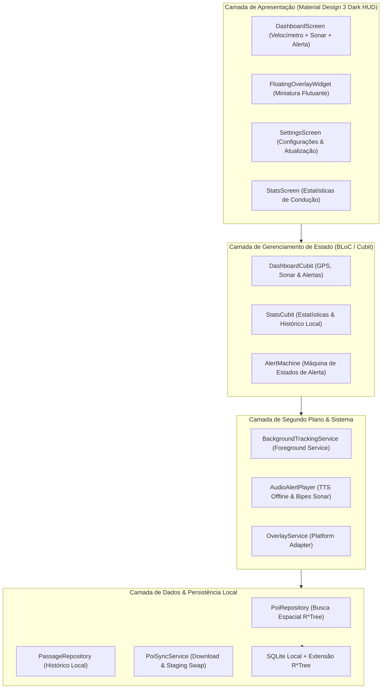

# Arquitetura do Sistema

A arquitetura do **Sentinela** é fundamentada em separação estrita de camadas e programação reativa com **BLoC / Cubit**, garantindo testabilidade hermética com cobertura $\ge 90\%$.

---

## 🏗️ Visão em Camadas



---

## 🧩 Detalhamento dos Módulos

```
sentinela/
├── lib/
│   ├── core/                  # Módulos puros (fórmulas geodésicas, AlertMachine, Audio)
│   │   ├── audio/             # Gerenciamento de áudio, TTS pt-BR e cadência sonar
│   │   ├── engine/            # AlertMachine (Máquina de estados finitos reativa)
│   │   ├── geo/               # Haversine, Bearing e Bounding Box
│   │   ├── models/            # POI, Radar, TrafficLight, VehiclePosition
│   │   └── theme/             # Material Design 3 Dark HUD de alto contraste
│   ├── data/                  # Persistência e comunicação com dados abertos
│   │   ├── database/          # SQLite R*Tree nativo pré-compilado
│   │   ├── repository/        # PoiRepository com Bounding Box
│   │   └── sync/              # In-App Sync Engine com Staging Swap atômico
│   ├── features/              # Apresentação e Telas do Condutor
│   │   ├── dashboard/         # HUD M3, velocímetro digital monoespaçado e sonar
│   │   ├── overlay/           # Miniatura flutuante Picture-in-Picture
│   │   ├── settings/          # Atualização in-app e preferências
│   │   └── stats/             # Estatísticas de conformidade e passagens
│   ├── background/            # Foreground Service e isolamento de ciclo de vida
│   └── main.dart              # Ponto de entrada do aplicativo
└── test/                      # Suíte de testes automatizados BDD/TDD (100% Hermética)
```

---

## ⚡ Fluxo de Execução Concorrente com Isolates

Para assegurar uma taxa de quadros ininterrupta de 60 a 120 fps no velocímetro durante a ingestão de bases de dados massivas com dezenas de milhares de registros, operações de rede e parsing JSON são descarregadas para `Isolates` independentes via `compute()`.
