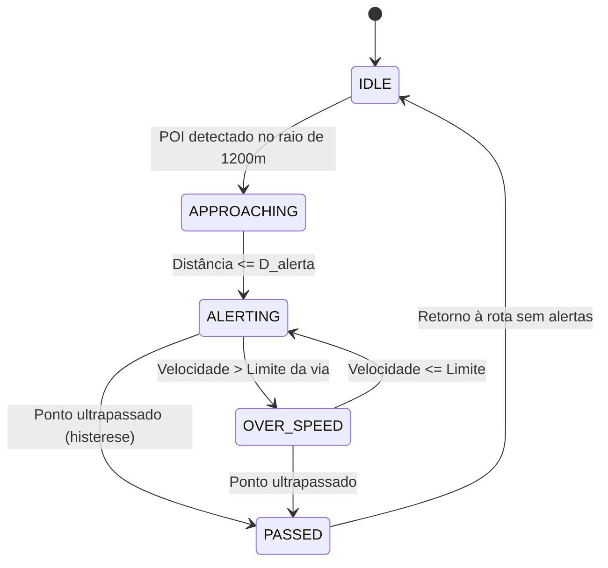

# Motor Matemático & Algoritmos de Alerta

O núcleo computacional do **Sentinela** executa em tempo real cálculos trigonométricos esféricos de alta precisão para prever trajetórias, descartar alertas em vias paralelas e calcular a cadência sonora ideal.

---

## 1. Distância Geodésica (Fórmula de Haversine)

A menor distância sobre a superfície do elipsoide terrestre entre o veículo $( \phi_1, \lambda_1 )$ e o ponto fiscalizado $( \phi_2, \lambda_2 )$ é dada por:

$$a = \sin^2\left(\frac{\Delta \phi}{2}\right) + \cos(\phi_1)\cos(\phi_2)\sin^2\left(\frac{\Delta \lambda}{2}\right)$$

$$d = 2 R \cdot \text{atan2}\left(\sqrt{a},\, \sqrt{1 - a}\right)$$

Onde $R \approx 6.371.000\text{ m}$ é o raio médio da Terra.

---

## 2. Rumo Inicial (Azimute de Aproximação)

O ângulo de visada direta do veículo até o POI ($\theta_{alvo}$) é calculado através da fórmula de azimute ortodrômico:

$$\theta_{alvo} = \text{atan2}\left(\sin(\Delta \lambda)\cos(\phi_2),\, \cos(\phi_1)\sin(\phi_2) - \sin(\phi_1)\cos(\phi_2)\cos(\Delta \lambda)\right)$$

Com normalização no anel modular $[0^\circ, 360^\circ)$:

$$\theta_{norm} = (\theta_{alvo} + 360^\circ) \pmod{360^\circ}$$

---

## 3. Filtragem Angular para Semáforos e Pistas Duplas

Para evitar que cruzamentos transversais (ruas a $90^\circ$) gerem alarmes indevidos para condutores que não passarão pelo semáforo:

1. **Cone Frontal de Visão:** O ponto deve estar situado no campo visual à frente do veículo ($|\theta_{carro} - \theta_{alvo}| \le 40^\circ$).
2. **Sentido Regulamentado:** A orientação da via onde o radar está instalado ($\theta_{radar}$) deve ser compatível com o rumo do automóvel ($\theta_{carro}$):

$$\Delta\theta = |\theta_{carro} - \theta_{radar}| \pmod{360^\circ}$$

$$\min(\Delta\theta,\, 360^\circ - \Delta\theta) \le \text{tolerância} \quad (\le 35^\circ)$$

Se o motorista transitar em rua ortogonal ou em sentido oposto em pista dupla, o filtro angular efetua o **descarte instantâneo** do ponto.

---

## 4. Distância Dinâmica de Antecipação

O Sentinela não dispara alertas a distâncias arbitrárias fixas. A distância ótima $D_{alerta}$ adapta-se à velocidade instantânea $v$:

$$D_{alerta} = \max\left(D_{min},\, v \cdot t_{antecipacao}\right)$$

| Categoria do Ponto | Tempo de Antecipação ($t$) | Distância Mínima ($D_{min}$) | Distância a 110 km/h |
| :--- | :---: | :---: | :---: |
| **Radar Fixo / Móvel** | $15\text{ s}$ | $200\text{ m}$ | $\approx 450\text{ m}$ |
| **Semáforo c/ Radar** | $10\text{ s}$ | $180\text{ m}$ | $\approx 250\text{ m}$ |
| **Lombada Eletrônica** | $8\text{ s}$ | $80\text{ m}$ | $\approx 120\text{ m}$ |
| **Lombada Física** | $8\text{ s}$ | $80\text{ m}$ | $\approx 100\text{ m}$ |
| **Praça de Pedágio / Free Flow** | $25\text{ s}$ | $800\text{ m}$ | $\approx 1.000\text{ m}$ |

---

## 5. Máquina de Estados de Alerta (FSM)

---

## 6. Fiscalização por Velocidade Média (Radar de Trecho / Section Control)

Em trechos monitorados por velocidade média, a autuação não depende da velocidade pontual no radar, mas do tempo total decorrido na travessia entre o **Pórtico A (Entrada)** e o **Pórtico B (Saída)**:

1. **Ativação por Azimute de Entrada:** O trecho é ativado quando o veículo ingressa no raio de detecção ($\le 80\text{ m}$) do Pórtico A com rumo compatível ($\Delta\theta \le 35^\circ$).
2. **Cálculo da Velocidade Média em Tempo Real:**
   $$v_{media} = \frac{\Delta s}{\Delta t} \cdot 3.6 \quad [\text{km/h}]$$
3. **Tempo Alvo Restante para Regularização ($t_{alvo}$):**
   Caso a velocidade média instantânea supere o limite regulamentado da via ($v_{limite}$), o Sentinela projeta quantos segundos o condutor precisa gastar no trecho remanescente para normalizar a média antes de cruzar o Pórtico B:
   $$t_{alvo} = \max\left(0,\, \frac{S_{total}}{v_{limite} / 3.6} - \Delta t\right) \quad [\text{s}]$$
4. **Desarme por Desvio ou Timeout:** Caso o condutor saia da rodovia ou estacione por mais de 30 minutos ($> 1.800\text{ s}$), o trecho é automaticamente desarmado sem falso-positivo.

---

## 7. Navegação Inercial & Dead Reckoning em Túneis

Em locais sem recepção de sinal de satélite (ex: Túneis Ayrton Senna, Rebouças, pistas cobertas), o **Sentinela** ativa o motor de **Odometria Inercial (Dead Reckoning)**:

1. **Detecção de Sinal Degradado ou Bloqueado:** Quando a precisão horizontal do GPS excede $40\text{ m}$ ou nenhum fix é recebido no intervalo regulamentar ($> 2.0\text{ s}$), o motor transiciona suavemente de `gpsLocked` para `deadReckoning`.
2. **Projeção Cinemática Great-Circle:**
   A posição geográfica estimada a cada segundo é propagada utilizando a última velocidade vetorial e rumo angular conhecidos:
   $$\phi_2 = \arcsin\left(\sin(\phi_1)\cos(\delta) + \cos(\phi_1)\sin(\delta)\cos(\theta)\right)$$
   $$\lambda_2 = \lambda_1 + \text{atan2}\left(\sin(\theta)\sin(\delta)\cos(\phi_1),\, \cos(\delta) - \sin(\phi_1)\sin(\phi_2)\right)$$
   Onde $\delta = \frac{d}{R}$ é a distância angular percorrida no intervalo de tempo.
3. **Amortecimento Inercial de Velocidade (Damping):** Aplica fator de decaimento suave ($0.995$ por segundo) para evitar superestimação do trajeto no interior do túnel.
4. **Alerta de Radares Internos:** Radares e redutores posicionados no interior do túnel são disparados regressivamente com precisão mesmo sem satélites visíveis.
5. **Recuperação e Histerese:** Ao cruzar a saída do túnel e receber fix GPS preciso ($\le 40\text{ m}$), o sistema se ancora nas coordenadas reais retornando para `gpsLocked`.

---

## 8. Perfis Veiculares conforme Código de Trânsito Brasileiro (CTB)

O Sentinela adequa dinamicamente as distâncias de antecipação e as regras de velocidade máxima ao veículo conduzido:

* **Automóvel / Utilitário Leve:** Multiplicador de antecipação $1.0\times$, aplicando o limite nominal de velocidade da via.
* **Motocicleta:** Multiplicador $0.95\times$, otimizado para a maior agilidade de frenagem e tempo de reação.
* **Veículo Pesado (Caminhões, Carretas e Ônibus):**
  - Multiplicador de antecipação $1.40\times$, expandindo o cone de alerta para garantir frenagem segura com carga.
  - Teto Legal do CTB (**Artigo 61**): Capping automático em **$90\text{ km/h}$** em rodovias federais e estaduais de pista dupla ou simples onde o limite geral para veículos leves for $\ge 100\text{ km/h}$.

---

## 9. Clusterização Espacial & Fusão Hierárquica de POIs

Em cruzamentos complexos e vias expressas onde múltiplos equipamentos de fiscalização atuam colocalizados (ex: radar de velocidade, semáforo com câmera de sinal vermelho e lombada no mesmo ponto):

1. **Agrupamento Geodésico:** POIs situados em raio $\le 45\text{ m}$ são agrupados em um único `PoiCluster`.
2. **Blindagem de Pistas Opostas:** Radares no mesmo raio físico com diferença azimutal $\ge 120^\circ$ (pistas duplas em sentidos contrários) **não** são agrupados.
3. **Hierarquia de Severidade:** O ponto de maior criticidade lidera o cluster:
   $$\text{Semáforo c/ Radar} > \text{Radar Fixo} > \text{Radar Móvel} > \text{Câmera Vermelho} > \text{Free Flow} > \text{Lombada}$$
4. **Locução TTS Composta Inteligente:** Evita redundâncias na fala (ex: *"Radar fixo, 60 km/h e fiscalização de sinal vermelho à frente"*).

---

## 10. Cálculo Crepuscular & Solar 100% Offline

Para máxima legibilidade diurna e proteção contra ofuscamento noturno e em túneis:

1. **Algoritmo NOAA Offline:** Calcula a equação do tempo e declinação solar astronômica diretamente das coordenadas de GPS do motorista, sem conexões de rede ou consultas meteorológicas.
2. **Modos de Tema (`HudThemeMode`):**
   - `darkOnly`: Tema escuro analítico contínuo (#121212).
   - `dayHighContrast`: Alto contraste para condução sob sol forte no para-brisa.
   - `solarAutomatic`: Chaveamento automático dia/noite pelo zênite solar oficial ($90^\circ 50'$ civil), com ativação imediata de superfície escura ao transitar por túneis.

---

## 11. Acessibilidade Universal (a11y), Semantics & Feedback Háptico Tátil

Para assegurar inclusão total a motoristas com deficiência visual ou auditiva, bem como maximizar a usabilidade em condições adversas de condução (alta incidência de luz solar ou trepidação veicular):

1. **Motor de Feedback Háptico Veicular (`HapticFeedbackEngine`):**
   - **5 Padrões Táteis Especializados:** `click` (interações da interface), `gentleNotice` (lombadas físicas e pedágios), `radarWarning` (aproximação preventiva a radares), `criticalOverSpeed` (pulsação vigorosa para excesso de velocidade) e `successConfirmation` (ultrapassagem de POI ou reporte rápido).
   - **Intensidades Configuráveis:** 4 níveis (`off`, `light`, `medium`, `strong`).
   - **Debounce de Segurança:** Limita repetições táteis de excesso de velocidade (intervalo padrão de 1.400 ms) para evitar fadiga do atuador e manter o motorista focado na via.
   - **Execução Desacoplada e Não-Bloqueante (`unawaited`):** Platform channels nativos de vibração rodam sem pausar ou atrasar os cálculos matemáticos do GPS ou as animações a 60/120 fps.

2. **Acessibilidade Semântica no Cockpit (Material Design 3):**
   - **Velocímetro Analítico:** Anotações semânticas (`Semantics`) com labels dinâmicos e valores tabulares de velocidade instantânea, limite da via e alerta de excesso.
   - **Sonar Radar M3:** Descrição acessível com contagem em tempo real das fiscalizações no cone frontal.
   - **Banner de Alerta:** Configurado como região ao vivo (`liveRegion: true`) para leitura imediata pelos leitores de tela do Android (TalkBack) e iOS (VoiceOver).
   - **Modo Alto Contraste:** Cores reforçadas e contornos com bordas acentuadas (`#FFFFFF` e `#000000`) para máxima legibilidade contra ofuscamento solar.

3. **Internacionalização Completa (i18n):**
   - Suporte multilíngue de primeira classe para Português (`pt`), Inglês (`en`) e Espanhol (`es`).
   - Dicionários semânticos nativos para todos os tipos de POIs e terminologia do cockpit.
   - Locução de áudio veicular TTS traduzida contextualmente (`TTSAlertFormatter`), permitindo condução assistida para usuários e turistas no Brasil e no exterior.
