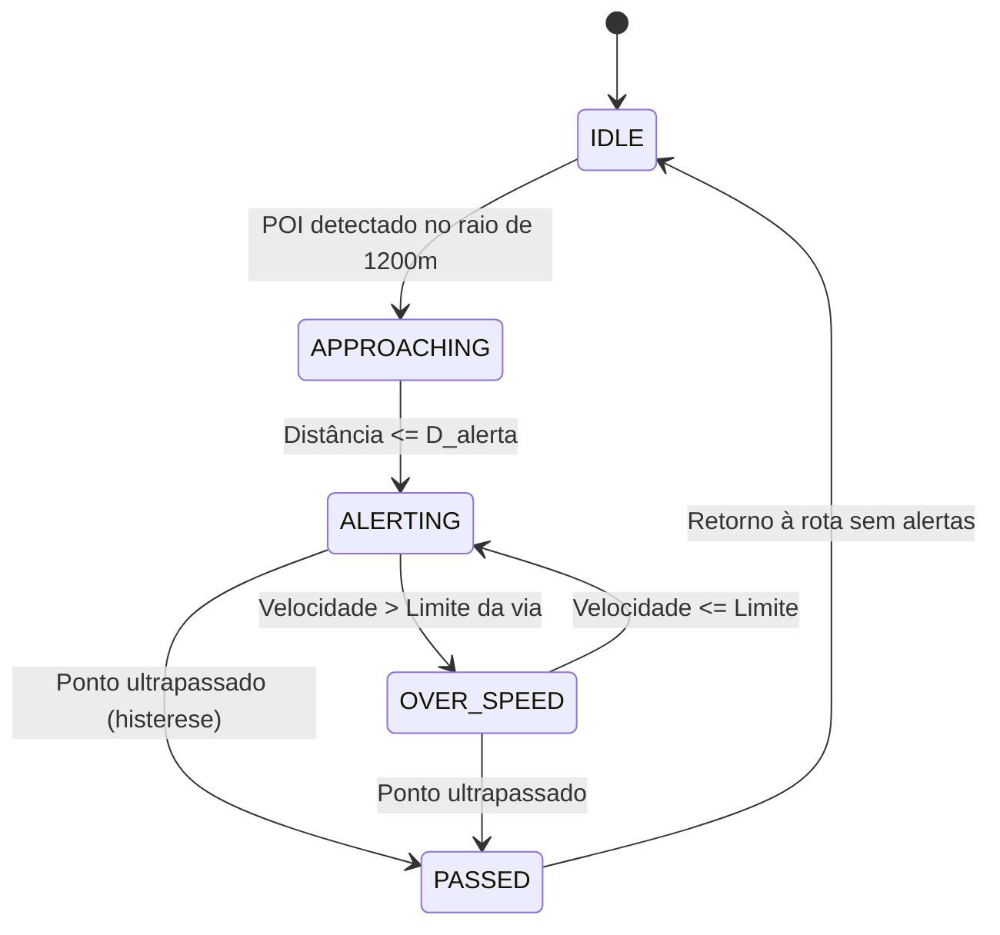

# Motor Matemático & Algoritmos de Alerta

O núcleo computacional do **Sentinela** executa em tempo real cálculos trigonométricos esféricos de alta precisão para prever trajetórias, descartar alertas em vias paralelas e calcular a cadência sonora ideal.

---

## 1. Distância Geodésica (Fórmula de Haversine)

A menor distância sobre a superfície do elipsoide terrestre entre o veículo $( \phi_1, \lambda_1 )$ e o ponto fiscalizado $( \phi_2, \lambda_2 )$ é dada por:

$$a = \sin^2\left(\frac{\Delta \phi}{2}\right) + \cos(\phi_1)\cos(\phi_2)\sin^2\left(\frac{\Delta \lambda}{2}\right)$$

$$d = 2 R \cdot \text{atan2}\left(\sqrt{a},\, \sqrt{1 - a}\right)$$

Onde $R \approx 6.371.000\text{ m}$ é o raio médio da Terra.

---

## 2. Rumo Inicial (Azimute de Aproximação)

O ângulo de visada direta do veículo até o POI ($\theta_{alvo}$) é calculado através da fórmula de azimute ortodrômico:

$$\theta_{alvo} = \text{atan2}\left(\sin(\Delta \lambda)\cos(\phi_2),\, \cos(\phi_1)\sin(\phi_2) - \sin(\phi_1)\cos(\phi_2)\cos(\Delta \lambda)\right)$$

Com normalização no anel modular $[0^\circ, 360^\circ)$:

$$\theta_{norm} = (\theta_{alvo} + 360^\circ) \pmod{360^\circ}$$

---

## 3. Filtragem Angular para Semáforos e Pistas Duplas

Para evitar que cruzamentos transversais (ruas a $90^\circ$) gerem alarmes indevidos para condutores que não passarão pelo semáforo:

1. **Cone Frontal de Visão:** O ponto deve estar situado no campo visual à frente do veículo ($|\theta_{carro} - \theta_{alvo}| \le 40^\circ$).
2. **Sentido Regulamentado:** A orientação da via onde o radar está instalado ($\theta_{radar}$) deve ser compatível com o rumo do automóvel ($\theta_{carro}$):

$$\Delta\theta = |\theta_{carro} - \theta_{radar}| \pmod{360^\circ}$$

$$\min(\Delta\theta,\, 360^\circ - \Delta\theta) \le \text{tolerância} \quad (\le 35^\circ)$$

Se o motorista transitar em rua ortogonal ou em sentido oposto em pista dupla, o filtro angular efetua o **descarte instantâneo** do ponto.

---

## 4. Distância Dinâmica de Antecipação

O Sentinela não dispara alertas a distâncias arbitrárias fixas. A distância ótima $D_{alerta}$ adapta-se à velocidade instantânea $v$:

$$D_{alerta} = \max\left(D_{min},\, v \cdot t_{antecipacao}\right)$$

| Categoria do Ponto | Tempo de Antecipação ($t$) | Distância Mínima ($D_{min}$) | Distância a 110 km/h |
| :--- | :---: | :---: | :---: |
| **Radar Fixo / Móvel** | $15\text{ s}$ | $200\text{ m}$ | $\approx 450\text{ m}$ |
| **Semáforo c/ Radar** | $10\text{ s}$ | $180\text{ m}$ | $\approx 250\text{ m}$ |
| **Lombada Eletrônica** | $8\text{ s}$ | $80\text{ m}$ | $\approx 120\text{ m}$ |
| **Lombada Física** | $8\text{ s}$ | $80\text{ m}$ | $\approx 100\text{ m}$ |
| **Praça de Pedágio / Free Flow** | $25\text{ s}$ | $800\text{ m}$ | $\approx 1.000\text{ m}$ |

---

## 5. Máquina de Estados de Alerta (FSM)

---

## 6. Fiscalização por Velocidade Média (Radar de Trecho / Section Control)

Em trechos monitorados por velocidade média, a autuação não depende da velocidade pontual no radar, mas do tempo total decorrido na travessia entre o **Pórtico A (Entrada)** e o **Pórtico B (Saída)**:

1. **Ativação por Azimute de Entrada:** O trecho é ativado quando o veículo ingressa no raio de detecção ($\le 80\text{ m}$) do Pórtico A com rumo compatível ($\Delta\theta \le 35^\circ$).
2. **Cálculo da Velocidade Média em Tempo Real:**
   $$v_{media} = \frac{\Delta s}{\Delta t} \cdot 3.6 \quad [\text{km/h}]$$
3. **Tempo Alvo Restante para Regularização ($t_{alvo}$):**
   Caso a velocidade média instantânea supere o limite regulamentado da via ($v_{limite}$), o Sentinela projeta quantos segundos o condutor precisa gastar no trecho remanescente para normalizar a média antes de cruzar o Pórtico B:
   $$t_{alvo} = \max\left(0,\, \frac{S_{total}}{v_{limite} / 3.6} - \Delta t\right) \quad [\text{s}]$$
4. **Desarme por Desvio ou Timeout:** Caso o condutor saia da rodovia ou estacione por mais de 30 minutos ($> 1.800\text{ s}$), o trecho é automaticamente desarmado sem falso-positivo.
